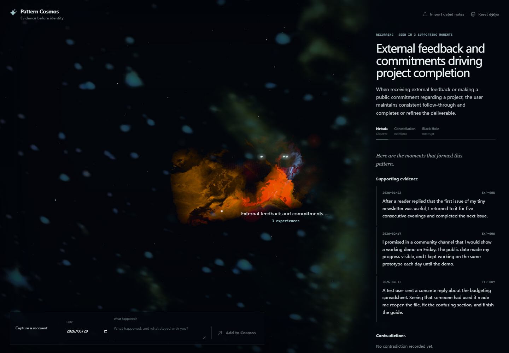
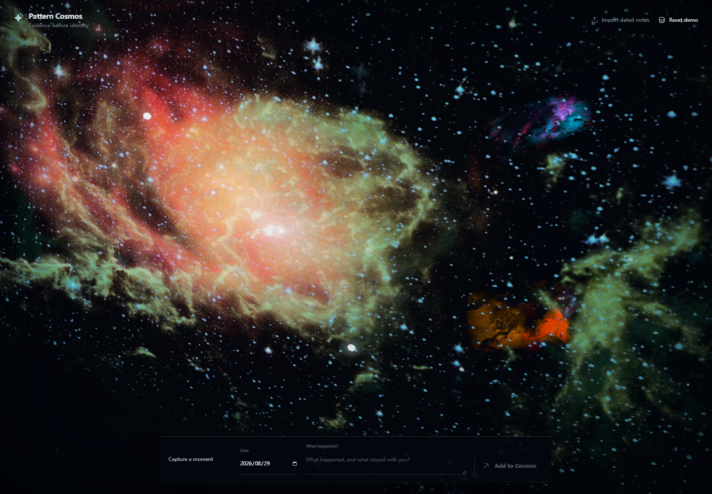
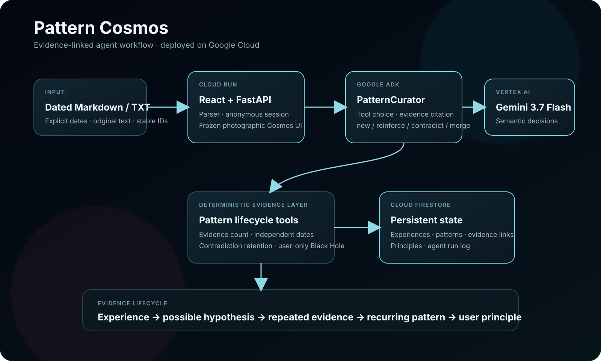

# Pattern Cosmos

### See the patterns behind your experiences. Choose what happens next.

Pattern Cosmos turns dated notes into an interactive 3D map of recurring behavior.
An evidence-constrained AI agent connects **trigger → response → outcome** pathways
across different moments, while keeping supporting evidence and contradictions visible.

**[Explore the demo](https://pattern-cosmos-946174509894.us-central1.run.app/?demo=1)**
· [Architecture](#how-it-works) · [Run locally](#run-locally)



## Why this project

Journal entries capture individual moments, but recurring mechanisms can be difficult to see
across weeks or months. Pattern Cosmos makes those connections explorable: open a nebula,
read the dated experiences behind it, inspect contradictions, and decide what to reinforce or change.

## What you can do

- **Build a personal cosmos.** Start with an empty world, add dated experiences, or import a small
  UTF-8 Markdown/TXT file. A synthetic demo is included for a quick walkthrough.
- **Discover mechanisms, not just topics.** A Google ADK agent inspects existing evidence and uses
  tools to create, reinforce, contradict, or propose a merge between pattern hypotheses.
- **Inspect every connection.** Explore photographic nebulae and evidence stars in 3D, then open
  a pattern to see the original experiences and dates behind it.
- **Keep recurrence grounded.** Deterministic Python code requires at least three supporting
  experiences on three independent dates before a hypothesis becomes recurring.
- **Choose your response.** Mark patterns as Nebula, Constellation, or Black Hole; explore a
  possible trajectory and draw an alternative orbit. Black Hole status remains a user decision.

<details>
<summary>Cosmos overview</summary>



</details>

*Screenshots show the competition prototype with synthetic demo experiences.*

## How it works



1. The React client sends a dated experience or a bounded note import to FastAPI.
2. **PatternCurator**, built with Google ADK and Gemini on Vertex AI, examines the existing state
   and calls evidence-management tools.
3. Python applies the evidence rules, preserves contradictions, and updates the pattern graph.
4. The client renders the result as an explorable cosmos. State uses local JSON in local mode
   or Firestore in the hosted configuration.

| Layer | Technology |
|---|---|
| Interface | React 19, TypeScript, Vite |
| 3D rendering | Three.js, React Three Fiber, Drei, postprocessing |
| API and evidence rules | Python, FastAPI, Pydantic |
| Agent | Google Agent Development Kit, Gemini on Vertex AI |
| Hosted infrastructure | Google Cloud Run, Cloud Firestore |

## Run locally

Requirements: **Python 3.11+**, **Node.js 22.12+**, and a Google Cloud project with Vertex AI
enabled. AI discovery and projection features require your own Google Cloud authentication and
available model access. The commands below use local JSON storage; Firestore is optional.

From the repository root, in PowerShell:

```powershell
python -m venv .venv
.\.venv\Scripts\python.exe -m pip install -e .
npm --prefix web ci
npm --prefix web run build
```

Authenticate with your own project using the Google Cloud CLI:

```powershell
gcloud auth application-default login

$env:GOOGLE_CLOUD_PROJECT = "YOUR_PROJECT_ID"
$env:GOOGLE_CLOUD_LOCATION = "global"
$env:GOOGLE_GENAI_USE_VERTEXAI = "TRUE"
$env:STATE_BACKEND = "local"
# Optional: select another Vertex AI model available to your project.
# $env:PATTERN_AGENT_MODEL = "YOUR_MODEL_ID"

.\.venv\Scripts\python.exe -m uvicorn web_api:app --host 127.0.0.1 --port 8000
```

Open **http://127.0.0.1:8000**. Add `?demo=1` to explore the seeded demo.
The original competition model default is `gemini-3.7-flash`; model availability and usage costs
depend on your Google Cloud project. Do not commit credentials or private notes.

For frontend development, keep the API running and use `npm --prefix web run dev`.
Vite proxies `/api` to port 8000. For a Firestore-backed instance, set `STATE_BACKEND=firestore`
and configure your project's Firestore database and permissions. A multi-stage `Dockerfile`
is included for container deployment.

### Import format

```markdown
# 2026-01-12
A concrete experience, in your own words.

# 2026-02-18
Another dated experience.
```

Plain `YYYY-MM-DD` headings and a single Markdown frontmatter `date:` are also accepted.
Undated entries are skipped. Imports are limited to 1 MB and 12 parsed entries per request;
stable IDs prevent duplicate imports of the same source entries.

## Project structure

```text
pattern_agent/                Agent tools, evidence lifecycle, import and persistence
web/src/                     React interface and 3D cosmos
web_api.py                   FastAPI endpoints and anonymous-session orchestration
base_experiences.json         Synthetic demo experiences
agent_detected_patterns.json  Demo pattern fixtures
examples/                    Sanitized import example
docs/                        Architecture and screenshots
Dockerfile                   Frontend build and Python API container
```

## Background and data

Created for the **[All Things Agentic Hackathon, August 2026](https://allthingsagentichackathon.devpost.com/)**.
The original competition implementation and Git history are preserved from
[Bitbucket](https://bitbucket.org/pattern-cosmos/pattern-cosmos/).
The storyboard and submission checklist remain in the repository as historical preparation records.

The public demo uses synthetic/sanitized experiences and anonymous sessions. **Do not upload
confidential journal entries to the public instance.** AI interpretations are hypotheses for
reflection; the supporting and contradicting evidence remains available for inspection.

The nebula texture uses **NASA/JPL-Caltech, PIA14728**. Source and attribution metadata are included
in [`web/public/assets/nasa-lagoon-nebula-pia14728.source.json`](web/public/assets/nasa-lagoon-nebula-pia14728.source.json).
